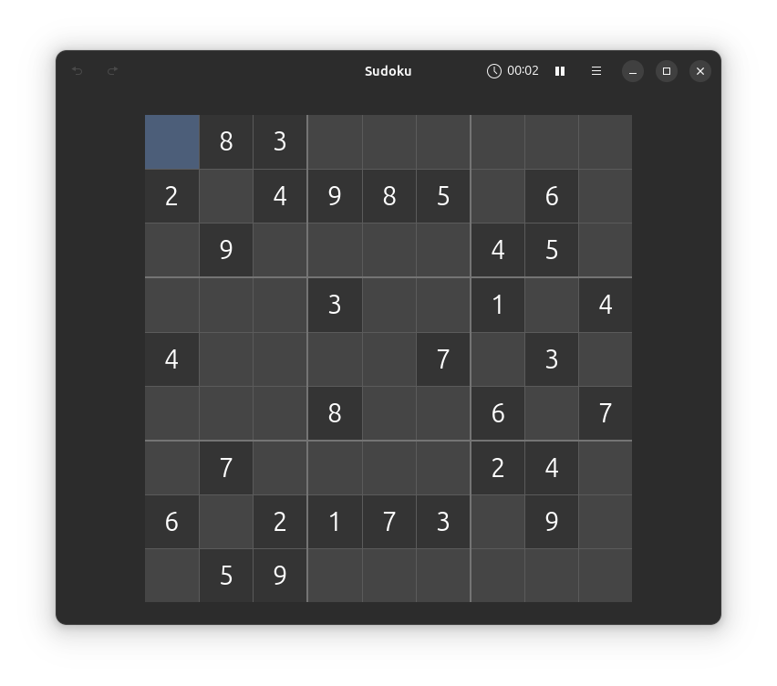
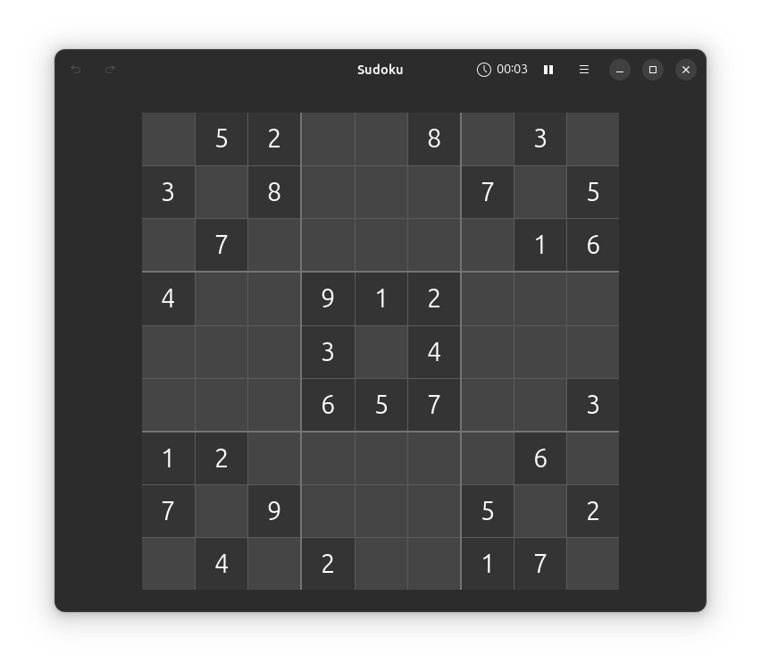
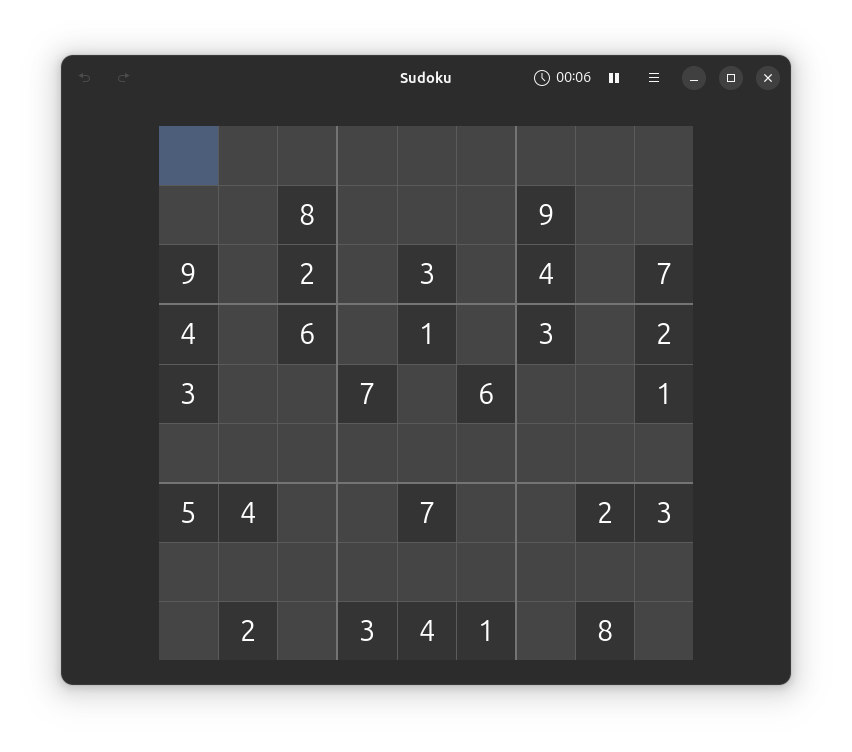
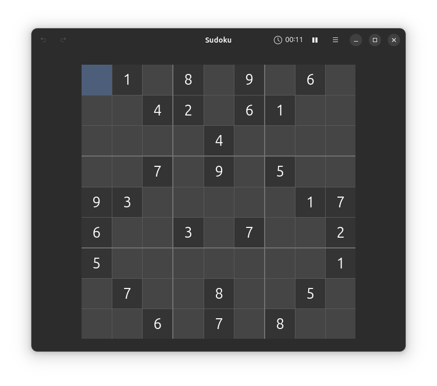

# Prolog Sudoku Generator & Solver

A Sudoku **generator and logical solver implemented in Prolog**, developed as an academic project to explore logic programming, candidate-based solving strategies, puzzle generation, and rule-based reasoning.

The project includes:

- Sudoku solving using logical candidate elimination
- Row, column, and 3×3 block validation
- Single-candidate resolution
- Pair-based candidate elimination
- Uniqueness-based solving
- Repeated solving passes
- Sudoku puzzle generation
- Multiple example puzzles with different difficulty levels

The implementation uses manual Prolog logic rather than a ready-made Sudoku or constraint-solving library.

---

## 🎯 Project Goal

The goal of this project is to model Sudoku as a logic-programming problem and implement the solving process manually in Prolog.

The project explores concepts such as:

- Logical inference
- Dynamic facts
- Candidate generation
- Candidate elimination
- Recursive search
- Backtracking
- Row constraints
- Column constraints
- 3×3 block constraints
- Puzzle generation
- Solvability checking

The solver focuses on logical Sudoku-solving techniques rather than replacing the problem with an external solver or high-level Sudoku library.

---

## 🧩 Sudoku Rules

A standard Sudoku puzzle uses a **9×9 grid**.

The goal is to fill every empty cell with a digit from `1` to `9` while satisfying three main constraints:

1. Each row must contain every digit from `1` to `9` without repetition.
2. Each column must contain every digit from `1` to `9` without repetition.
3. Each 3×3 block must contain every digit from `1` to `9` without repetition.

The project represents and validates these constraints directly in Prolog.

---

## 🧠 Solver Overview

The solver represents Sudoku cells using dynamic `cell/4` facts and applies repeated logical passes to reduce the possible values of unsolved cells.

The refactored source documents the following main solving stages:

- Candidate initialization
- Single-candidate propagation
- Pair elimination
- Uniqueness checks
- Repeated scan passes

These strategies were preserved from the original implementation during the repository refactor. :chatgpt-content-reference{index="1"}

---

## 🔍 Solving Strategies

### Candidate Elimination

For every unresolved cell, the solver determines possible values based on:

- values already present in the same row
- values already present in the same column
- values already present in the same 3×3 block

Invalid candidates are removed until the solver can determine a valid value.

---

### Single-Candidate Resolution

When an unresolved cell has only one remaining possible value, that value can be assigned to the cell.

This is conceptually related to the **naked single** technique described in standard Sudoku-solving terminology. Sudoku9x9 describes a naked single as a cell where only one candidate digit remains. :chatgpt-content-reference{index="2"}

---

### Uniqueness-Based Resolution

The solver also looks for situations where a particular candidate can only appear in one valid location within a row, column, or square.

This is conceptually related to the **hidden single** technique, where only one cell in a unit can accept a particular digit. :chatgpt-content-reference{index="3"}

---

### Pair-Based Elimination

The implementation contains pair-based candidate elimination logic.

When two related cells constrain the same pair of values, those candidates can be removed from other relevant cells where appropriate.

Pair-based reasoning is one of the more advanced Sudoku-solving ideas documented in standard Sudoku technique references. :chatgpt-content-reference{index="4"}

---

### Repeated Solving Passes

The solver repeatedly applies its logical strategies to the board.

As new values are discovered, candidate sets change, which can make additional cells solvable during later passes.

---

## 🏗️ Puzzle Generator

The repository also includes a Sudoku puzzle generator.

The generator follows the original project workflow:

1. Build a complete Sudoku grid
2. Validate row constraints
3. Validate column constraints
4. Validate 3×3 block constraints
5. Remove selected cells
6. Check the resulting puzzle using the project solver
7. Continue generating/removing cells according to the original generation behavior

The generation logic and random behavior were intentionally preserved during the refactor. :chatgpt-content-reference{index="5"}

> Difficulty in this project is based on the original generator and solver behavior rather than a formal modern Sudoku difficulty-rating system.

---

## 📊 Example Puzzles

The repository contains several sample puzzles:

```text
examples/
├── easy.pl
├── medium.pl
├── hard.pl
├── very_hard.pl
├── input.pl
└── input1.pl
```

These examples were preserved exactly during the refactor. :chatgpt-content-reference{index="6"}

Screenshots corresponding to the sample puzzles are stored under:

```text
docs/images/
```

---

## 🖼️ Example Difficulty Screenshots

Example Sudoku screenshots are available for different puzzle difficulty levels.

### Easy

<p align="center">
  
</p>

### Medium

<p align="center">
  
</p>

### Hard

<p align="center">
  
</p>

### Very Hard

<p align="center">
  
</p>

---

## 🏛️ Project Structure

```text
prolog-sudoku-generator-solver/
├── src/
│   ├── sudoku_solver.pl
│   └── sudoku_generator.pl
│
├── examples/
│   ├── easy.pl
│   ├── medium.pl
│   ├── hard.pl
│   ├── very_hard.pl
│   ├── input.pl
│   └── input1.pl
│
├── docs/
│   ├── images/
│   │   ├── easy.png
│   │   ├── medium.png
│   │   ├── hard.png
│   │   ├── very_hard.png
│   │   ├── input.png
│   │   └── input1.png
│   │
│   ├── Aleppo University.docx
│   ├── Aleppo University.pdf
│   ├── Sudoku_Creation_and_Grading.pdf
│   └── solve_sudoku.pdf
│
├── .gitignore
├── README.md
├── REFACTOR_NOTES.md
└── LICENSE
```

The original source files were renamed and reorganized into this structure during the refactor. :chatgpt-content-reference{index="7"}

---

## 🧩 Main Components

### `src/sudoku_solver.pl`

Contains the Sudoku-solving logic.

Its responsibilities include:

- representing Sudoku cells
- initializing candidates
- checking possible values
- eliminating invalid candidates
- detecting single candidates
- applying pair-based elimination
- performing uniqueness checks
- repeating solving passes
- producing solved results

---

### `src/sudoku_generator.pl`

Contains the Sudoku-generation logic.

Its responsibilities include:

- creating valid Sudoku values
- validating rows
- validating columns
- validating 3×3 squares
- generating a complete board
- removing values
- using the solver to check generated puzzles

The generator explicitly loads the solver because it depends on solver predicates such as `solvePuzzle/1`. :chatgpt-content-reference{index="8"}

---

### `examples/`

Contains sample Sudoku puzzles at multiple difficulty levels and additional input examples.

The puzzle contents were preserved during the refactor.

---

### `docs/`

Contains:

- Academic reports
- Project documentation
- Example screenshots

---

## 🚀 Getting Started

### 1. Install SWI-Prolog

This project is intended to be run with a Prolog environment such as **SWI-Prolog**.

Verify your installation with:

```bash
swipl --version
```

---

### 2. Clone the Repository

```bash
git clone https://github.com/Mahmoudmnb/prolog-sudoku-generator-solver.git
cd prolog-sudoku-generator-solver
```

---

## ▶️ Running the Solver

Load the solver:

```bash
swipl -s src/sudoku_solver.pl
```

Or load the solver together with an example puzzle:

```bash
swipl -s src/sudoku_solver.pl -s examples/easy.pl
```

Then run the solver predicate:

```prolog
solvePuzzle(Result).
```

A command-line example is:

```bash
swipl -q \
  -s src/sudoku_solver.pl \
  -s examples/easy.pl \
  -g "solvePuzzle(R),writeln(R),halt."
```

---

## 🛠️ Running the Generator

Load the generator:

```bash
swipl -s src/sudoku_generator.pl
```

The generator already depends on and loads the solver source.

The exact public generator predicates remain based on the original implementation.

---

## 🧪 Code Quality & Refactoring

The project was refactored for readability and portfolio presentation without intentionally changing the original Sudoku logic.

The refactor improved:

- Repository structure
- File naming
- Documentation
- Source-code comments
- Separation of source files and examples
- Organization of screenshots
- Organization of academic documentation

The following were intentionally preserved:

- Sudoku solving logic
- Candidate elimination behavior
- Pair/uniqueness strategies
- Sudoku generation logic
- Random generation behavior
- Difficulty behavior
- Sample puzzle contents

More details are available in:

```text
REFACTOR_NOTES.md
```

The refactor did not rename internal predicates because the solver and generator contain many interdependent predicates, cuts, dynamic facts, and cross-file calls. :chatgpt-content-reference{index="9"}

---

## ⚠️ Educational / Experimental Notes

This repository represents the original educational implementation, so several design choices were intentionally preserved.

### Dynamic Puzzle State

The solver relies on dynamic `cell/4` facts together with:

```prolog
assert/1
retract/1
```

Because puzzle state is stored dynamically, users should avoid loading multiple puzzle samples into the same Prolog session without clearing existing state.

---

### Custom `append/3`

The solver contains its own `append/3` predicate.

This overlaps with a common Prolog predicate name, but it was preserved because both the solver and generator depend on the project's local behavior.

---

### `not/1`

The project uses `not/1` in some predicates.

Some Prolog implementations prefer:

```prolog
\+/1
```

The existing form was preserved to avoid changing the original implementation.

---

### Solver Completeness

The solver implements a specific collection of logical strategies.

It may not solve every valid Sudoku puzzle, especially puzzles requiring techniques beyond the implemented candidate, pair, and uniqueness passes.

---

### Difficulty Rating

The generator's difficulty behavior is tied to cell removal and whether the current solver can solve the resulting puzzle.

It should therefore not be considered a rigorous universal Sudoku difficulty-rating system.

These limitations were intentionally documented instead of silently changing the original project. :chatgpt-content-reference{index="10"}

---

## ✅ Validation

During the refactor, repository-level checks were successfully performed, including:

```bash
git diff --check
```

and verification that moved puzzle files, screenshots, and reports preserved their contents.

Runtime validation was not available in the refactoring environment because no Prolog runtime was installed there. :chatgpt-content-reference{index="11"}

Recommended SWI-Prolog validation commands are:

```bash
swipl -q -t halt -s src/sudoku_solver.pl
swipl -q -t halt -s src/sudoku_generator.pl
swipl -q \
  -s src/sudoku_solver.pl \
  -s examples/easy.pl \
  -g "solvePuzzle(R),writeln(R),halt."
```

---

## 🔮 Possible Future Improvements

Potential future improvements include:

- Add automated solver regression tests
- Add generator validation tests
- Add a safe `clearPuzzle/0` helper
- Improve predicate naming with compatibility wrappers
- Add deterministic generation through optional random seeds
- Improve difficulty classification
- Add more logical Sudoku strategies
- Improve portability across Prolog implementations
- Add a command-line interface
- Add board visualization
- Add solver performance measurements
- Add puzzles requiring progressively more advanced techniques

These should be introduced separately from the original educational implementation so that the original logic remains understandable.

---

## 🎓 Academic Context

This project was developed as an academic exercise in logic programming and artificial-intelligence-style problem solving.

It demonstrates how a structured puzzle can be modeled using Prolog facts, predicates, logical constraints, recursion, and backtracking.

The repository also contains the original academic reports under:

```text
docs/
```

---

## 📚 References

Sudoku-solving terminology and techniques were studied with the help of:

- [Sudoku9x9 — Sudoku Solving Techniques](https://www.sudoku9x9.com/techniques/)

The reference explains techniques including hidden singles, naked singles, candidate elimination approaches, pairs, and more advanced solving strategies. :chatgpt-content-reference{index="12"}

This repository implements its own Prolog-based solver and generator. It does **not** claim to implement every technique described by the reference.

---

## 🛠️ Tech Stack

- Prolog
- Logic programming
- Recursive reasoning
- Backtracking
- Dynamic predicates
- Candidate elimination
- Rule-based Sudoku solving

---

## 📌 Project Status

**Academic / educational project**

The repository demonstrates a manually implemented Sudoku solver and generator using Prolog.

It is intended primarily for education, experimentation, and portfolio presentation rather than as a production Sudoku engine.

---

## 👨‍💻 Author

**Mahmoud Bannan**

Flutter Developer & Audio AI Engineer

- GitHub: [@Mahmoudmnb](https://github.com/Mahmoudmnb)
- Portfolio: [mahmoudbannan.com](https://mahmoudbannan.com)

---

## 📄 License

This project is licensed under the MIT License. See the [`LICENSE`](LICENSE) file for details.